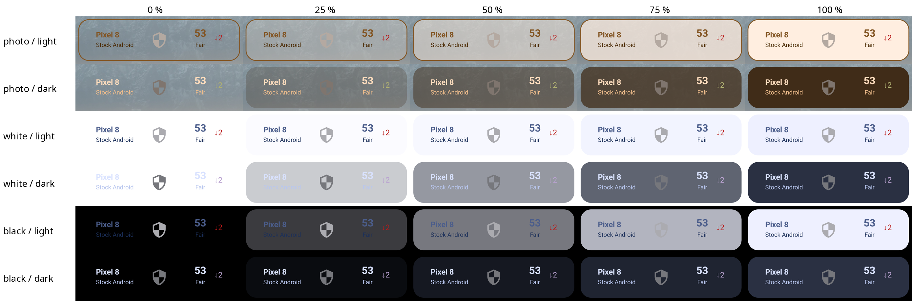

# Widget readability: decision paper

Read-only design run, 2026-10-21. Branch `docs/widget-readability`. No code changed.
Evidence: `docs/screens/2026-10-21-widget-readability/` (Pixel 8, Android 17 `CP3A.260905.009`, Pixel Launcher).

**Decision needed from Oliver:** pick option A, B or C (recommendation: **B**), and the four defaults in "Oliver's calls" at the end.

---

## 1. How the widget colours itself today

| Piece | API 31+ light (`layout-v31`) | API 31+ dark (`layout-night-v31`) | API 26–30 (`layout/`) |
|---|---|---|---|
| Card background | `system_accent2_50` (tone 95) | `system_accent2_800` (tone 20) | `#004225` light / `#1C1B1F` dark |
| Device name, score | `system_accent1_600` (T40) | `system_accent1_100` (T90) | Cream, set in code |
| OS name, rating | `system_accent1_800` (T20) | `system_accent1_200` (T80) | Cream, set in code |
| Shield icon | `system_neutral1_300` (T70) | `system_neutral1_500` (T50) | Cream |
| ↑ / ↓ delta | `#0B4619` / `#BA1A1A` (`values/colors.xml`) | `system_accent1_200` / `system_accent3_300` | `0xFFA5D6A7` / `0xFFEF9A9A`, set in code |

- **Opacity** (`PrivacyWidgetProvider.updateWidget`): the slider value (0–100, float, `widget_preferences` / `widget_opacity_<id>`)
  goes only to the background `ImageView`: `setFloat("setAlpha")` on API 31+, `setInt("setImageAlpha")` below.
  Text and icon stay fully opaque, in colours chosen for the card at 100 %.
- **Material You**: the API 31+ tokens come from the system palette, which follows the wallpaper. The app itself does not
  use dynamic colour (fixed British Racing Green scheme), so widget and app don't share colours. White and black
  wallpapers both gave the same default blue palette, because a colourless wallpaper has no seed hue (`c4-home.png`, `c5-home.png`).
- **Light/dark**: by resource qualifier (`-night-v31`), so the launcher re-resolves colours when the theme changes. That is why
  the code avoids `setTextColor` on API 31+ (the comment at `PrivacyWidgetProvider.kt:163`).

## 2. Why readability drops

The text colours are picked for one background: the card at 100 %. With the slider lower, the background behind the text is
`opacity × card + (1 − opacity) × wallpaper`. The text colour never moves, so:

- **Theme against wallpaper.** Light theme means dark text. On a dark wallpaper, as opacity falls, the blended background darkens
  *through the text's own tone*, so contrast passes, collapses, and partly recovers. Example: black wallpaper, light theme,
  device name: 5.7 → 3.1 → **1.5** → 1.7 → 3.2 at 100/75/50/25/0 %. The mirror happens in dark theme on a light wallpaper:
  white wallpaper, dark theme, rating at 25 %: **1.1:1**.
  The "bad at *some* levels" Oliver sees is this dip in the middle of the range.
- **The icon fails everywhere.** The shield uses a mid-grey neutral tone (T70 light, T50 dark) that is only 2.0:1 and 2.9:1
  against the card even at 100 %. With translucency it drops to 1.0–1.3 where the blend matches its grey. Of all elements it
  sits closest to the card's tone, so it is "even worse", as reported.
- **The dark-theme "down" delta isn't red.** `system_accent3_300` is the wallpaper's tertiary hue: olive `#AEAF71` on the
  photo wallpaper, lavender `#B9A2D0` on white or black. A drop in score doesn't read as bad.
- **Secondary text is darker than primary** in light theme (T20 vs T40), so "Pixel 8" and "53", the most important text, have the
  lower contrast (5.7 vs 11.6 at 100 %).

**Physical limit:** with any text colour, guaranteeing 4.5:1 over *every* wallpaper needs at least **49 %** opacity for black
text on a light card, and **60 %** for white text on a dark card (`floors.md`). Below that, no fixed colour works for all
wallpapers. The widget would have to know what is behind it, or carry its own shadow.

## 3. Measurements (Pixel 8)

**Method:**
- device-verify placed the debug widget (4×1, id 16) and set the opacity directly in `widget_preferences.xml` via `run-as`.
  It broadcast `ACTION_UPDATE_WIDGET` and took a screenshot at 0/25/50/75/100 %.
- This ran on 3 wallpapers: the phone's photo (Floating Himalayas; the widget sat over grey rock), solid **White** and solid **Black**.
- Each wallpaper was measured in the light and dark system theme (`cmd uimode night`).
- `contrast.py` takes each element's box from the UI dump. It takes the glyph mask and the text colour from the 100 % shot, since the
  text colour doesn't change with opacity. Then it computes the WCAG contrast against every background pixel in the box.
- The table shows the worst 5 %. **Bold = fails.** Targets: 4.5:1 for 14–18sp text, 3:1 for the 24sp bold score and for the icon.
- The measured 100 % values match the tone model in `floors.py` to within 0.1 (for example 5.73 measured vs 5.7 modelled), so the floors in §4 can be trusted.

| Wallpaper | Theme | Element | Colour | Need | 0 % | 25 % | 50 % | 75 % | 100 % |
|---|---|---|---|---|---|---|---|---|---|
| photo | light | device name | `#825422` | 4.5 | **1.9** | **2.6** | **3.5** | **4.5** | 5.7 |
| photo | light | OS name | `#4A2900` | 4.5 | **3.8** | 5.2 | 7.0 | 9.0 | 11.5 |
| photo | light | score | `#825422` | 3.0 | **2.0** | **2.7** | 3.5 | 4.5 | 5.7 |
| photo | light | rating | `#4A2900` | 4.5 | **4.0** | 5.4 | 7.1 | 9.1 | 11.5 |
| photo | light | shield icon | `#B4A9A1` | 3.0 | **1.4** | **1.1** | **1.2** | **1.6** | **2.0** |
| photo | light | delta down | `#BA1A1A` | 4.5 | **2.0** | **2.7** | **3.5** | 4.5 | 5.7 |
| photo | dark | device name | `#FFDCBD` | 4.5 | **2.3** | **3.2** | 4.7 | 7.0 | 10.2 |
| photo | dark | OS name | `#EFBD8C` | 4.5 | **1.8** | **2.5** | **3.6** | 5.4 | 7.8 |
| photo | dark | score | `#FFDCBD` | 3.0 | **2.3** | 3.2 | 4.6 | 7.0 | 10.2 |
| photo | dark | rating | `#EFBD8C` | 4.5 | **1.7** | **2.4** | **3.5** | 5.2 | 7.8 |
| photo | dark | shield icon | `#7F756E` | 3.0 | **1.3** | **1.0** | **1.4** | **2.1** | **2.9** |
| photo | dark | delta down | `#AEAF71` | 4.5 | **1.3** | **1.8** | **2.6** | **3.9** | 5.8 |
| white | light | device name | `#4B5D8B` | 4.5 | 6.5 | 6.3 | 6.1 | 5.9 | 5.7 |
| white | light | OS name | `#1B2F59` | 4.5 | 13.2 | 12.7 | 12.4 | 12.0 | 11.6 |
| white | light | score | `#4B5D8B` | 3.0 | 6.5 | 6.3 | 6.1 | 5.9 | 5.7 |
| white | light | rating | `#1B2F59` | 4.5 | 13.2 | 12.7 | 12.4 | 12.0 | 11.6 |
| white | light | shield icon | `#ABABB0` | 3.0 | **2.3** | **2.2** | **2.2** | **2.1** | **2.0** |
| white | light | delta down | `#BA1A1A` | 4.5 | 6.5 | 6.3 | 6.1 | 5.9 | 5.7 |
| white | dark | device name | `#D9E2FF` | 4.5 | **1.3** | **1.2** | **2.2** | 4.6 | 10.2 |
| white | dark | OS name | `#B8C6EE` | 4.5 | **1.7** | **1.1** | **1.7** | **3.5** | 7.7 |
| white | dark | score | `#D9E2FF` | 3.0 | **1.3** | **1.2** | **2.2** | 4.6 | 10.2 |
| white | dark | rating | `#B8C6EE` | 4.5 | **1.7** | **1.1** | **1.7** | **3.5** | 7.7 |
| white | dark | shield icon | `#76777C` | 3.0 | 4.5 | **2.8** | **1.6** | **1.3** | **2.9** |
| white | dark | delta down | `#B9A2D0` | 4.5 | **2.3** | **1.4** | **1.3** | **2.6** | 5.7 |
| black | light | device name | `#4B5D8B` | 4.5 | **3.2** | **1.7** | **1.5** | **3.1** | 5.7 |
| black | light | OS name | `#1B2F59` | 4.5 | **1.6** | **1.2** | **3.0** | 6.4 | 11.6 |
| black | light | score | `#4B5D8B` | 3.0 | 3.2 | **1.7** | **1.5** | 3.1 | 5.7 |
| black | light | rating | `#1B2F59` | 4.5 | **1.6** | **1.2** | **3.0** | 6.4 | 11.6 |
| black | light | shield icon | `#ABABB0` | 3.0 | 9.2 | 4.9 | **1.9** | **1.1** | **2.0** |
| black | light | delta down | `#BA1A1A` | 4.5 | **3.2** | **1.7** | **1.5** | **3.1** | 5.7 |
| black | dark | device name | `#D9E2FF` | 4.5 | 16.3 | 15.2 | 13.7 | 12.0 | 10.2 |
| black | dark | OS name | `#B8C6EE` | 4.5 | 12.3 | 11.5 | 10.4 | 9.1 | 7.7 |
| black | dark | score | `#D9E2FF` | 3.0 | 16.3 | 15.2 | 13.7 | 12.0 | 10.2 |
| black | dark | rating | `#B8C6EE` | 4.5 | 12.3 | 11.5 | 10.4 | 9.1 | 7.7 |
| black | dark | shield icon | `#76777C` | 3.0 | 4.7 | 4.4 | 4.0 | 3.5 | **2.9** |
| black | dark | delta down | `#B9A2D0` | 4.5 | 9.1 | 8.5 | 7.7 | 6.8 | 5.7 |

Full table with blended background colours: `measurements.md`. Theory per token pair: `floors.md`.

**Summary:**
- Only 100 % passes for all text in every combination.
- The icon fails in every combination at 100 %.
- Theme and wallpaper that "agree" (light on white, dark on black) pass at any opacity.
- Where they "disagree", text fails from 0 % up to 50–75 %.
- The photo wallpaper behaves like a mid-grey: some text fails in both themes up to 50–75 %.

**Not measured:**
- The ↑ (green) delta: the score only fell during the run, and faking a rise would mean writing `score_history`. Its colours
  have the same tones as the ↓ ones (`#0B4619` is darker, `system_accent1_200` is T80), so it follows the same pattern.
- **Android 8–11:** see §6, item 4.

## 4. Options

All three keep one structural layout per style. On API 31+ they set colours with `RemoteViews.setColorInt(id, method, day, night)`,
so light/dark still switches on the launcher side without a stale `setTextColor`. That API exists in the platform since API 31;
the implementation run must confirm it on the Pixel 8. Effort assumes the gate is a device sweep like this run's.

### A. Readability floor: always a card

- The slider range becomes **70–100 %**. A stored value below 70 shows as 70; nothing is rewritten in prefs.
- The tokens change so that 70 % passes on *any* wallpaper (`floors.md`):
  - light theme: card T95, primary text T10 (`accent1_900`), secondary T20, shield T30;
  - dark theme: card T10 (`accent2_900`), primary T95, secondary T90, shield T80.
- **Pros:** simplest; contrast is guaranteed by arithmetic, not by guessing the wallpaper. No new prefs key. Fixes the icon.
- **Cons:** drops the see-through widget. Anyone at 0–69 % today gets a visible card after the update, which is a visible behaviour change on F-Droid.
- **Effort:** S (about a day with the device sweep). **Risk:** low.

### B. Floor plus a "No background" style (recommended)

- Everything in A, plus a **Background** switch on the configuration screen.
- Off stores opacity **0**, which already means "no card", so the existing key and values keep their meaning.
- With 0, the widget uses a second layout: text and icon drawn straight on the wallpaper, styled like the launcher's own
  labels. That means white with a dark shadow (`android:shadowColor` in XML; shadows can't be set through `RemoteViews`).
  When the wallpaper reports `WallpaperColors.HINT_SUPPORTS_DARK_TEXT`, it uses dark text with no shadow instead.
  Pixel Launcher did exactly this in this run: white date text on the photo, black on the White wallpaper (`c4-home.png`).
  `getWallpaperColors` needs no permission (API 27+); API 26 falls back to white with shadow.
- Stored values 1–69 % show as 70 %.
- **Pros:**
  - keeps the transparent look for users who chose it;
  - text is never dark-on-dark or light-on-light, because the no-card style follows the same signal as the launcher's labels;
  - the card style is guaranteed as in A.
- **Cons:**
  - two layouts to keep in step (and the legacy pair);
  - shadowed text has no clean WCAG number, so its gate is "at least as readable as the launcher's own labels on the same wallpaper", judged on the photo, White and Black;
  - the wallpaper hint is global (not the patch behind the widget), and no broadcast reaches the widget when the wallpaper
    changes, so the text colour can be stale until the next update (≤ 6 h, app scan, or boot);
  - values between 1 and 69 % are no longer available.
- **Effort:** M (about 2 days). **Risk:** medium, all of it in the no-card style.

### C. Adaptive foreground over the full 0–100 % range (not recommended)

- Keep the slider. At each update, estimate the blended background `opacity × card + (1 − opacity) × wallpaper` and pick
  near-black or near-white text, whichever contrasts more. Either one always reaches ≥ 4.58:1 against a known background.
- **The catch is "known".** The widget cannot see the pixels behind it. `WallpaperColors` gives whole-wallpaper colours, but the
  launcher decides where the widget sits and pans the wallpaper between pages.
- In this run the photo's palette was warm cream and brown, while the patch behind the widget was blue-grey rock (`#839099`).
  An estimate from the palette would have picked the wrong colour, which is today's bug in a new form.
- Like B, it has no wallpaper-change callback.
- **Effort:** M–L. **Risk:** high.

### Icon: outlined or filled

Keep the **filled** half-shield (`Icons.Default.Security` path) and give it a text-strength tint (T30 light, T80 dark, or white/dark
in the no-card style). An outlined shield has 2dp strokes: at the same colour it reads weaker than a filled one, and it fails
sooner on a busy photo. Being decorative (`contentDescription` null), it is not strictly bound by WCAG 1.4.11, but it was the
worst element, so the gate holds it to 3:1 anyway.

## 5. Recommendation: B, with the widget pack in the same implementation run

B fixes the actual complaint (mid-range dips and the icon) with guaranteed numbers, and it doesn't take away the transparent widget.
The widget-pack items fit as follows:

- **Score tint by rating** (audit M15):
  - set the score's colour per rating with `setColorInt` day/night pairs; fixed hex, kept as named constants (CONVENTIONS);
  - the hues match the app's `ScoreCard`: green for Excellent/Good, teal for Fair, red for Poor/Critical;
  - the tones are set so 70 % still passes 3:1 for the 24sp bold score: light `#004225` / `#224C58` / `#93000A`, dark `#93D5AA` / `#A3CDDB` / `#FFB4AB`; every floor is ≤ 64 %;
  - the app's own Fair teal `#3B6470` would need a 74 % floor, which is why the widget uses the darker teal;
  - in the no-card style the score keeps the plain text colour, because a tint plus shadow on a photo is unreliable.
- **"↓2 pts" with a unit, coloured by direction** (audit M7, L5):
  - `fmt_widget_delta_up/down` become plurals ("↑1 pt", "↑4 pts");
  - the colours are the green and red above, which also fixes the olive/lavender "down" in dark theme;
  - at 18sp regular the delta needs 4.5:1, which these colours only reach from 75–76 %. So make it **20sp bold** (WCAG large
    text, 3:1, floor ≤ 64 %), or raise the floor to 76 % (see Oliver's calls);
  - the wording should follow whatever M7 settles for the app ("today" or no timeframe).
- **Large text at font scale 2.0** (audit H2: "40" and "↑15" overlap; "Needs", "Stock A…"):
  - the new layouts drop the `RelativeLayout` anchors for two weighted columns, with score and delta in one horizontal group so they can't overlap;
  - labels get `maxLines=1` + ellipsize, and the score `autoSizeTextType="uniform"` with today's size as the maximum;
  - `resizeMode` becomes `horizontal|vertical`, so someone with large text can make it 4×2;
  - the gate is a font-scale-2.0 screenshot on the Pixel 8 in both styles.
  - A dedicated large-text layout chosen from `fontScale` at update time is not recommended: font-scale changes send the widget no update, so it would be stale.
- **Configuration screen** (audit M16, still open: no preview): the switch and the 70–100 % slider sit there anyway. A live preview is optional.

**Implementation run gate** (Pixel 8): repeat this run's sweep with `contrast.py` on photo/White/Black × light/dark at
0 (no card), 70 and 100 %. Every card shot must pass the targets. No-card shots are compared side by side with the launcher's labels.
External review applies: the run touches the `widget_preferences` values (risky-code list), but not the key name.

## 6. Other findings

1. **Dead colour resources:** `values-night-v31/colors.xml` defines `widget_background`, `widget_primary_text`,
   `widget_secondary_text` and `widget_divider`, but the v31 layouts reference `@android:color/system_*` directly. Only the
   delta colours there are used. Code reading, not device-checked.
2. **`widget_privacy.xml` (all three) preview text** is "Pixel 9 / GrapheneOS / 85 Excellent". Fine as a sample; M15 is done.
3. **`ScoreCard.kt:119`** comments `tertiary` as "Fair (orange-ish)", but it is teal (`#3B6470` / `#A3CDDB`). The comment is wrong; behaviour is fine.
4. **Hypothesis, not verified: on Android 8–11 the opacity slider likely does nothing.**
   - The background drawable is the `ImageView`'s `android:background`, but the legacy path calls `setImageAlpha`, which only affects `android:src`.
   - The Pixel 8 (API 37) can't show it; it needs an API 30 emulator, and none is set up (`microg_test_api35` is API 35).
   - The fix belongs in the implementation run: move the drawable to `android:src`.
5. **The widget update receiver is exported** with a custom action, so any app can make Privamatic run a full scan. The cost is
   battery only, with no data exposed. A permission or a non-exported second receiver would close it; this is low priority.

## Oliver's calls (defaults to build)

| Question | Default |
|---|---|
| Option | **B** |
| Card floor | **70 %** (all neutral text 4.5:1, score/icon/delta 3:1 on any wallpaper); strict alternative 76 % keeps an 18sp regular delta at 4.5:1 |
| Stored 1–69 % | Shown as 70 %; 0 stays "no background" |
| Delta | 20sp bold, coloured green/red, plural "pt/pts" |
| Fair tint | App-matching teal, darkened to `#224C58` (light) |
